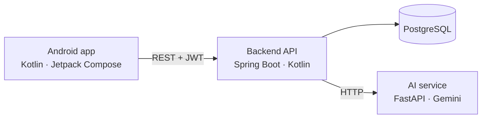

# Dexter

**Swap what you know for what you want to learn.**
Dexter is a skill-exchange app: people list the skills they can teach and the ones they want to learn, get matched with someone whose skills complement theirs, and follow a plan of sessions to teach each other. An AI service proposes the session dates based on both people's availability and time zones.

Built as a team project for the Mobile Programming course (EIF411) at Universidad Nacional de Costa Rica, 2026.

---

## Features

- **Accounts & onboarding**: registration, login with JWT, profile with bio, country, phone and skills
- **Search**: browse skill categories, popular skills and people who offer a given skill
- **Matching**: send, accept or reject match requests; contact info is only shown once a match is accepted
- **AI session plan**: when a match is accepted, a 6-session plan is generated with dates that fit both users' availability (round-robin fallback when there is no overlap)
- **Sessions**: create, edit, reschedule and complete sessions; sessions are renumbered automatically by date
- **Reviews & ratings** after completing an exchange
- **Notifications** with per-type filters
- **Admin dashboard** and settings

## Architecture



| Part | Stack |
|---|---|
| `android/` | Kotlin, Jetpack Compose, Material 3, Clean Architecture (data / domain / presentation), Hilt, Retrofit + OkHttp, DataStore, Coil, Firebase |
| `backend/` | Kotlin, Spring Boot 4, Spring Security + JWT, Spring Data JPA, PostgreSQL, MapStruct, deployed on Heroku |
| `backend/ai-service/` | Python, FastAPI, Google Gemini (with automatic fallback between API keys) |

## Repository structure

```
dexter/
├── android/          Android client (Jetpack Compose)
│   └── app/src/main/java/com/dexter/app/
│       ├── data/          API services, DTOs, mappers, repositories, DI
│       ├── domain/        models and repository contracts
│       └── presentation/  screens, view models, navigation, theme
└── backend/          REST API (Spring Boot)
    ├── src/main/kotlin/com/dexter/backend/
    │   ├── controller/  service/  repository/  entity/
    │   ├── dto/  mapper/  security/  config/  error/
    ├── ai-service/   session-planning microservice (FastAPI + Gemini)
    └── postman/      API test collections
```

## Running it locally

**Backend**
```bash
cd backend
docker compose up -d db          # PostgreSQL on localhost:5432
export JWT_SECRET=<any-long-random-string>
./gradlew bootRun                # API on http://localhost:3000/v1
```

**AI service**
```bash
cd backend/ai-service
cp .env.example .env             # add your own Gemini API key
pip install -r requirements.txt
uvicorn main:app --reload
```

**Android app**
1. Open `android/` in Android Studio.
2. Add your own `google-services.json` in `android/app/` (Firebase project).
3. Run on an emulator; the app points to `http://10.0.2.2:3000/v1/` (the host machine).

> Secrets (API keys, JWT secret, Firebase config) are not included in this repository and are read from environment variables or local files.

## Team

| | Main contributions |
|---|---|
| **Yassir Jiménez Carballo** ([@yassir2804](https://github.com/yassir2804)) | Android project setup (Clean Architecture, Hilt, Retrofit, theme), login, migration from mock data to the real API, notifications, session editing, input validation, Firebase; on the backend: the AI session-planning service with Gemini, the 6-session plan and session renumbering, match/session/notification endpoints and DTO conventions |
| **Saúl** ([@saulfrancisvargas](https://github.com/saulfrancisvargas)) | Features across the app and the API: match and session states, availability, profile photos, data seeding |
| **Manuel De Almada Rodríguez** ([@ryleecito](https://github.com/ryleecito)) | REST endpoints (profile, matches, search, sessions, notifications, reviews), JWT security, Postman test suites, multi-language support |

The full commit history of both the app and the API is preserved in this repository.
